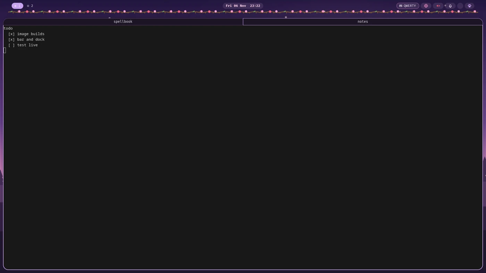
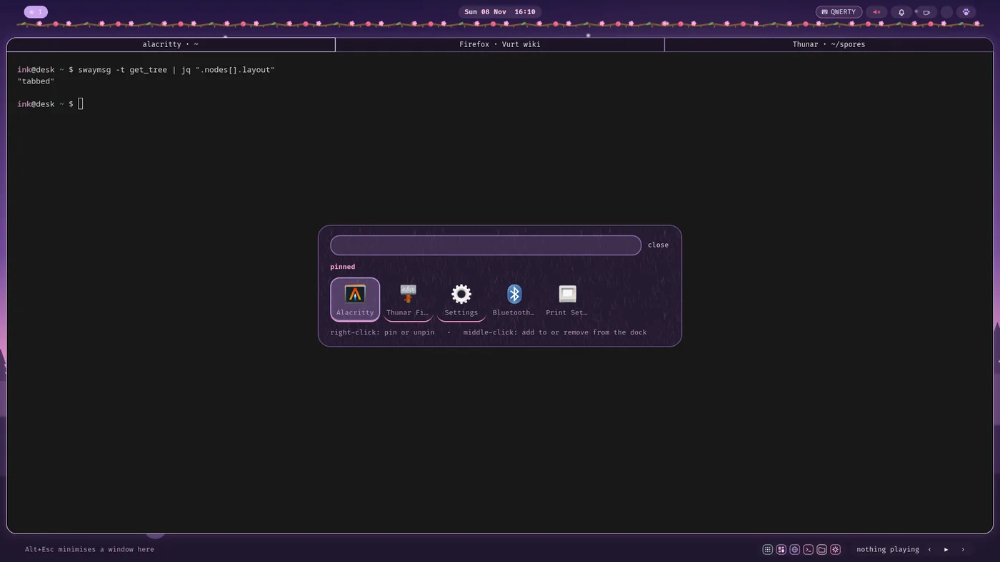
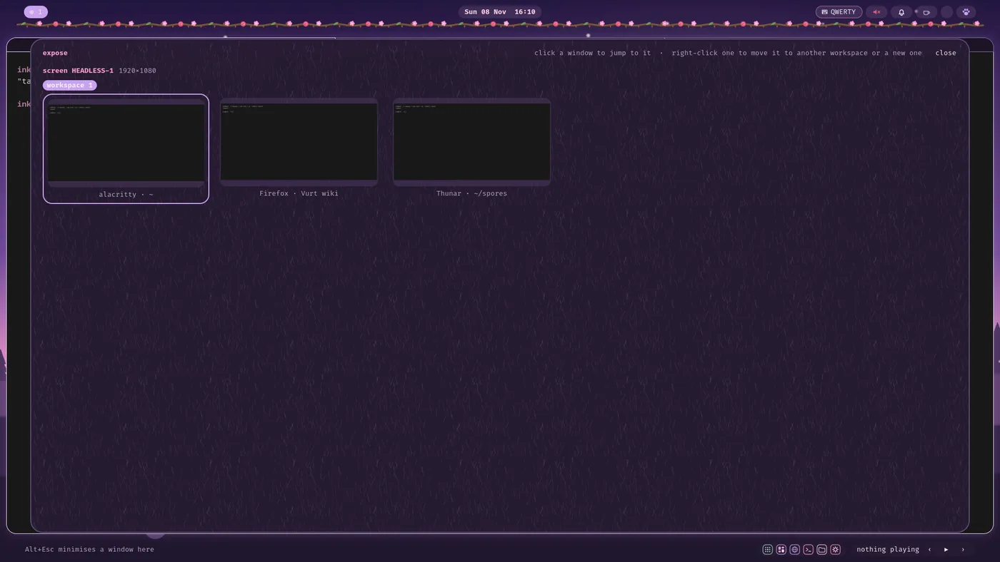
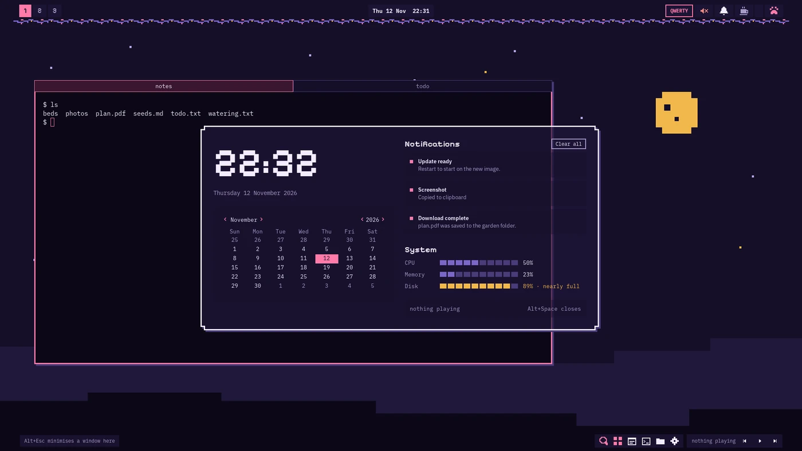
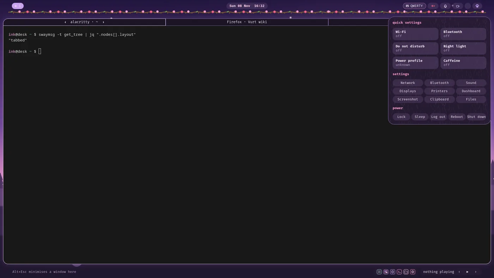
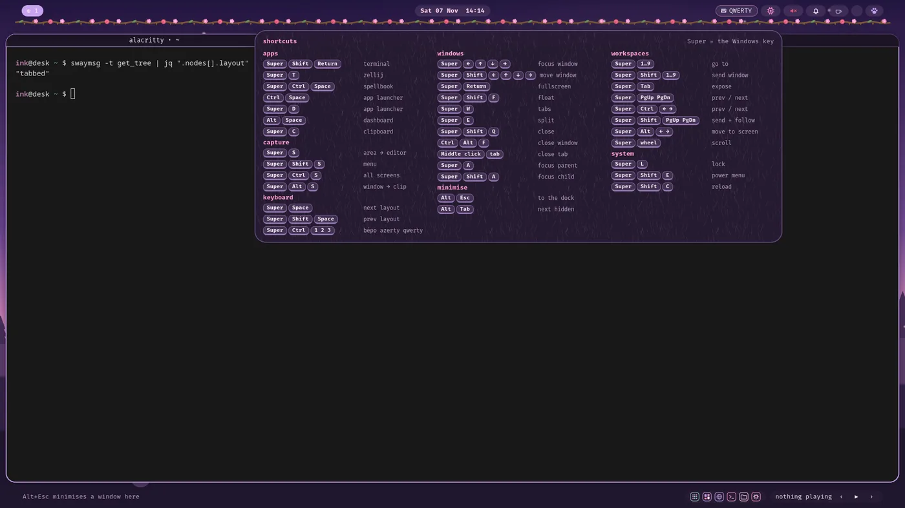
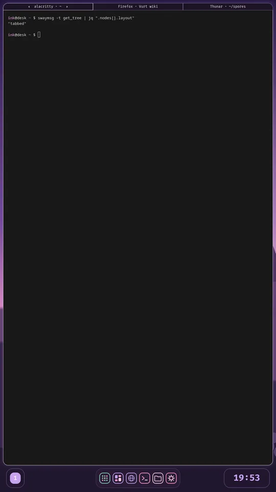
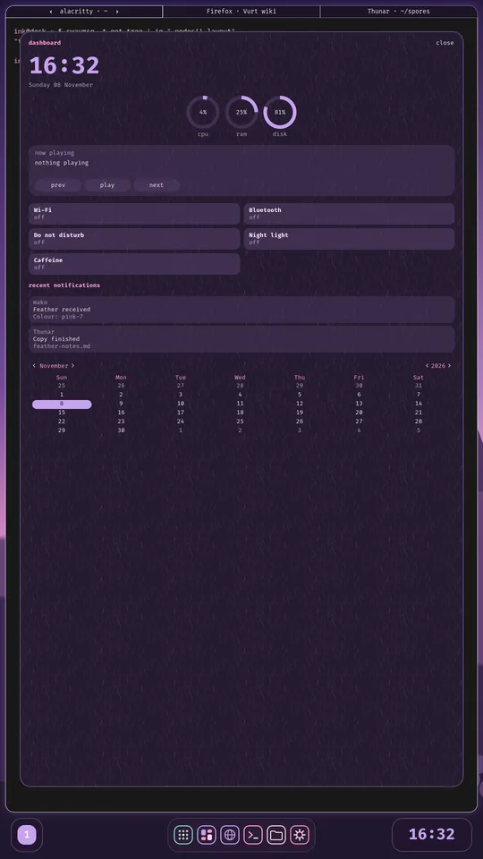

# Ink desktop on Bazzite

A [Universal Blue](https://universal-blue.org/) image: [Bazzite](https://bazzite.gg/) (GNOME) with a second desktop, **swayfx + eww**, in light purple and pink, with a thorny branch of flowers under the bar. The Sway session is chosen from the GDM login screen; GNOME stays as a fallback.



The screenshots below are taken from the real desktop (sway + eww in a headless session), not from a mock-up.

Everything lives in `build_files/`. The image is built by GitHub Actions and signed with cosign.

## What you get

| Piece | What it does |
| --- | --- |
| **swayfx** | Compositor: blur, shadows, rounded corners. Windows open as **tabs** by default |
| **eww bar** (landscape screens) | Workspaces of that screen, clock, keyboard layout, volume (sliders and output / input pickers), notifications, caffeine button (no auto-lock, no screen blanking, no idle suspend), tray, quick-settings menu |
| **eww strip** (landscape screens) | A 36 px strip at the bottom: minimised windows on the left (click to bring one back), then a small dock (launcher, dashboard and your apps) and the media player on the right. Windows stop above it |
| **eww dock** (portrait screens) | Launcher, dashboard, your apps and minimised windows, centred at the bottom, with the screen's workspaces at its left and a clock (time only) at its right, all of the dock's height. No bar on portrait screens |
| **Launcher** (`Ctrl+Space`) | Pinned apps, type to search, `↑` `↓` `Tab` to select, `Enter` to start. Right-click an app to pin or unpin it (up to 8), middle-click to add it to the dock or remove it; a line under the search field confirms each change |
| **Dashboard** (`Alt+Space`) | Time, CPU/RAM/disk, media player, toggles, calendar, notifications. A wide layout and a long one for portrait screens |
| **Expose** (`Super+Tab`) | Every workspace and window as a thumbnail, grouped by screen, click one to jump to it, right-click one then click a workspace, or "+ new workspace" of a screen, to move it there (eww has no real drag and drop) |
| **Window pill** | An outline around the title of the focused window with `‹` before it and `›` after it: push the window to the previous / next / a new workspace (it follows you); middle click closes the window |
| **Workspace layout** | The third fixed item of the dock, after the launcher and the dashboard (also in the small dock of a landscape screen), shows the layout of the container that holds the windows shown on that screen; each screen has its own. Click it (like the launcher and the dashboard) to open the picker: `H` `V` `T` `S` or a click choose, `Esc` or another click closes. `Super+G` opens a picker under the mouse for the focused window only (its own group, new windows open inside it; `H` `V` `T` `S`, `Esc` cancels). The system chip is gone from the bar: cpu, ram and disk are in the dashboard |
| **Keyboard** | qwerty (default), azerty and bépo, switched live and shown in the bar |
| **Caffeine** | The cup in the bar (also a tile in the quick settings and the dashboard) keeps the screen awake: no automatic lock, no blanking, until you click it again or log out. The lock before a suspend stays |
| **Screenshots** | Area, window, screen or output; copy, save or annotate; optional 5 s delay |
| **Minimise** | `Alt+Esc` sends a window away (to the dock on a portrait screen, to the bottom strip on a landscape one), `Alt+Tab` brings the next one back |

### Launcher and expose




### Dashboard and menus





### Portrait screens

The bar is replaced by a dock, with that screen's workspaces at its left and a clock at its right, and the dashboard becomes a single column. Each screen is judged on its own shape, and the layout follows when you plug, unplug or rotate a screen.

| Dock | Dashboard |
| :---: | :---: |
|  |  |

## Install

Switch an existing Fedora Atomic / Universal Blue machine to this image:

```bash
sudo bootc switch ghcr.io/inkunome/cosmic-bazzite
systemctl reboot
```

At the GDM login screen, pick the **Sway** session. To go back: `sudo bootc rollback`.

The image is named after the repository (`cosmic-bazzite`). Rename the repository on GitHub if you want a different image name; the workflow follows it.

New users get the desktop configuration automatically. For an existing home directory, copy it in once with:

```bash
ink-sync        # backs up ~/.config/{sway,eww,mako,fuzzel,swaylock}, then installs the defaults
```

Then reload Sway with `Super+Shift+C`.

Verify the signature with the key in this repository:

```bash
cosign verify --key cosign.pub ghcr.io/inkunome/cosmic-bazzite
```

## Shortcuts

`Super` is the Windows key. Letters and number keys are bound by **key position**, so they stay in the same place in qwerty, azerty and bépo. Hover the keyboard layout in the bar for the full sheet (it opens under that item).

| Keys | Action |
| --- | --- |
| `Super+Shift+Return` | terminal |
| `Super+T` | zellij in a terminal |
| `Super+Ctrl+Space` | spellbook: zellij session `code` |
| `Ctrl+Space`, `Super+D` | app launcher (`↑` `↓` `Tab` `Shift+Tab` select, `Enter` start) |
| `Alt+Space` | dashboard |
| `Super+Tab` | expose |
| `Super+C` | clipboard history |
| `Super+←↑↓→` / `Super+Shift+←↑↓→` | focus / move a window |
| `Super+Return`, `Super+F` | fullscreen |
| `Super+Shift+F` | floating |
| `Super+W`, `Super+E` | tabs, split |
| `Super+G` | picker under the mouse: layout of the focused window itself (its own group, new windows open inside it), then `H` `V` `T` `S`, `Esc` cancels |
| `Super+A`, `Super+Shift+A` | focus parent, child container |
| `Super+Shift+Q` | close |
| `Ctrl+Alt+F`, middle click on a tab | close the window, close that tab |
| `Alt+Esc`, `Alt+Tab` | minimise (dock or strip), next minimised window |
| `Super+1…9`, `Super+Shift+1…9` | go to a workspace, send the window there |
| `Super+PgUp/PgDn`, `Super+Ctrl+←/→` | previous / next workspace |
| `Super+Alt+←/→` | move the workspace to another screen |
| `Super+S` | screenshot: area, then annotate |
| `Super+Shift+S` | screenshot menu (mode, action, delay) |
| `Super+Ctrl+S`, `Super+Alt+S` | screenshot: all screens, window |
| `Super+Space` | next keyboard layout (qwerty, azerty, bépo) |
| `Super+Ctrl+1/2/3` | set bépo / azerty / qwerty |
| `Super+L` | lock the screen (with your wallpaper) |
| `Super+Shift+E` | power menu |
| `Super+Shift+C` | reload Sway |

In the launcher, dashboard and expose, `Esc` closes the panel.

## Software kit

Installed in `build_files/build.sh`. COPRs: `swayfx/swayfx`, `varlad/eww`, `varlad/zellij`, `leloubil/wl-clip-persist`; they are left disabled after the build.

| Role | Packages |
| --- | --- |
| Compositor and session | `swayfx`, `swaybg`, `swayidle`, `swaylock`, `kanshi`, `wlr-randr`, `wdisplays`, `xdg-desktop-portal-wlr`, `xdg-desktop-portal-gtk` |
| Bar, dock, panels | `eww` |
| Launcher and menus | `fuzzel`, `wlogout` |
| Notifications and clipboard | `mako`, `cliphist`, `wl-clipboard`, `wl-clip-persist` |
| Screenshots | `grim`, `slurp`, `swappy` |
| System | `brightnessctl`, `playerctl`, `pavucontrol`, `wlsunset`, `udiskie`, `network-manager-applet`, `nm-connection-editor`, `blueman`, `mate-polkit`, `system-config-printer` |
| Apps and tools | `alacritty`, `zellij`, `thunar`, `fira-code-fonts`, `jq`, `socat`, `nix` |
| Command-line tools | `ripgrep`, `fd-find`, `chafa`, `neovim` |

Already in the Bazzite base and used by the desktop: NetworkManager, Bluetooth, PipeWire / WirePlumber, `tuned-ppd` (power profiles), GNOME Settings, gvfs, udisks2.

## Where things are

| Path in the image | Content |
| --- | --- |
| `/etc/skel/.config/sway/config` | Sway config: look, keys, autostart, keyboard layouts |
| `/etc/skel/.config/eww/` | `eww.yuck` (widgets), `eww.scss` (style), `scripts/`, `icons/` |
| `/etc/skel/.config/{mako,fuzzel,swaylock}/` | Notifications, launcher styling, lock screen |
| `/etc/skel/.config/zellij/` | Zellij defaults and the `ink` theme (the same palette as the desktop) |
| `/etc/skel/.config/alacritty/` | Terminal padding |
| `/usr/bin/ink-layout` | Keyboard layout switcher (`next`, `set <name>`, `watch`) |
| `/usr/bin/ink-screenshot` | Screenshot tool (`area`, `window`, `screen`, `output` × `copy`, `save`, `edit`) |
| `/usr/bin/ink-scratch` | Minimise to the scratchpad, cycle, list |
| `/usr/bin/ink-lock` | Lock the screen with the wallpaper of each screen (what `Super+L`, the power menu and the idle timeout run) |
| `/usr/bin/ink-sync` | Copy the default configuration into your home |
| `/usr/share/backgrounds/ink/` | Wallpapers: `lilac-dusk` (default), `forest-night`, `ink-feathers`, `loam-moss` |

### Make it yours

- **Your own settings**: put them in `~/.config/ink/sway.d/*.conf` (wallpapers, per-device input, extra keys). Sway reads them last, so they override the defaults, and `ink-sync` never touches them.
- **Wallpaper**: in that folder, `output "<make> <model> <serial>" bg /path/to/image.png fill` (one line per screen; `swaymsg -t get_outputs` shows the names). Without it you get the default, set by the `output * bg …` line in the Sway config. The lock screen uses the same images, screen by screen.
- **Keep a keyboard in qwerty**: `input "<identifier>" { xkb_layout "us"  xkb_variant "" }` in a file of that folder (identifiers: `swaymsg -t get_inputs`). That keyboard then ignores the layout switch.
- **Pinned apps**: the launcher keeps them in `~/.config/ink/pinned` (one desktop-file id per line); right-click an app to pin or unpin it.
- **Dock apps** (both kinds of screen, small in the bottom strip on landscape ones): `~/.config/ink/dock`, one id per line, starting with `browser`, `terminal`, `files` and `settings`. Middle-click an app in the launcher to add it, right-click an icon in the dock to remove it.
- **Colours**: the palette is at the top of `eww.scss` and in the `set $…` lines of the Sway config.
- **Terminal**: `~/.config/alacritty/alacritty.toml` (new users get padding by default; `ink-sync` leaves your terminal config alone).
- **Keyboard layouts**: `input type:keyboard` in the Sway config; keep `NAMES` in `/usr/bin/ink-layout` in the same order.
- **Monitors**: `wdisplays` for a quick layout. To keep positions and rotation across reloads and reboots, write a `~/.config/kanshi/config`; `kanshi` then starts by itself and re-applies it after every reload.

## Build and test

```bash
just build          # podman build of the image, tagged cosmic-bazzite:latest
just build-qcow2    # disk image to try it in a VM (needs bootc-image-builder)
just run-vm-qcow2
just check          # lint the Justfile
```

GitHub Actions (`.github/workflows/build.yml`) builds the image on every pull request and publishes and signs it when something lands on `main`, and every day at 10:05 UTC to follow Bazzite. Add your cosign private key as the `SIGNING_SECRET` repository secret; the public key is `cosign.pub`. ISO builds (`build-disk.yml`) run on demand.

## Notes

- Built for eww 0.6: monitors are addressed by index, and `Ctrl+Space` is a global shortcut, so applications do not get it (editor autocompletion, input methods).
- The panels that open on hover sit at a fixed distance from the right edge of the bar; adjust the `:x` of each window in `eww.yuck` if one is off on your screen (the shortcut sheet is aligned with the keyboard layout pill, which moves left when the tray gets more icons).
- This eww has no `poll` command: values that change on demand (the dock list, the launcher marks) are plain variables pushed by the scripts, the rest is polled.
- Menus of tray icons and tooltips are drawn by GTK; `eww.scss` styles them, since `* { all: unset }` would leave them as bare text.
- The lock screen is plain `swaylock` showing your wallpaper (`ink-lock` reads the `output … bg` lines of the Sway config and of `~/.config/ink/sway.d/`); `swaylock-effects` (blur, clock) is not packaged for Fedora 45.
- Expose keeps the last thumbnail of windows it cannot capture, so a window on another workspace may show an older picture.
